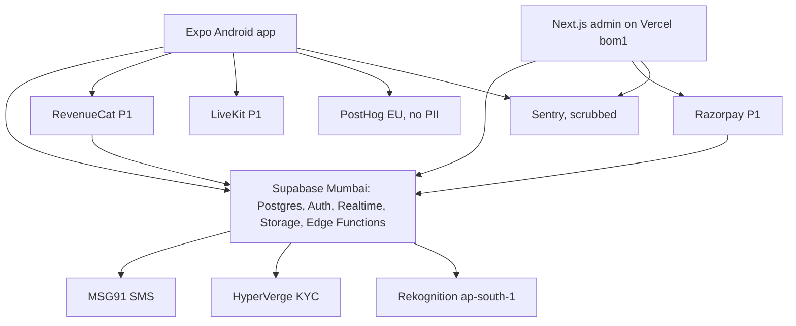
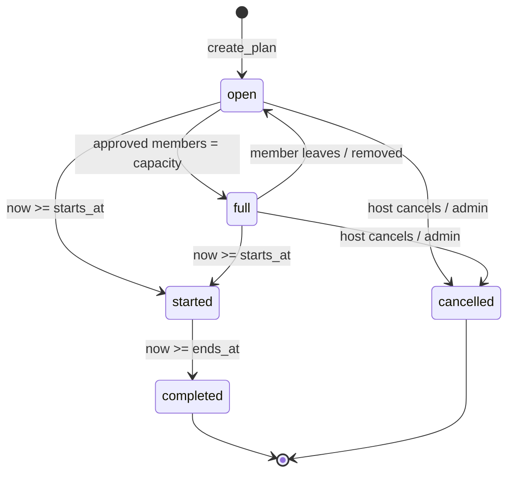

# Architecture

## System



Principles:

1. **Supabase is the product backend.** Plans, membership, chat, moderation, and safety rules live in Postgres with RLS. No second application server in P0.
2. **Buy regulated or slow pieces.** SMS delivery (DLT), KYC, image moderation, store billing, and payments are vendors. Each is called only from server code (Edge Function or admin server action), never directly with a secret from the app.
3. **Chat stays on Supabase Realtime.** Message text never leaves the Mumbai project. Stream and Sendbird are rejected for P0 because they would copy message content to a non-India vendor.
4. **Analytics and crash reports carry a user ID only.** No phone, name, photo, bio, or message text.

## Monorepo

Created in the first code slice, not in this docs pass.

```
apps/
  mobile/        Expo, Expo Router, HeroUI Native, Uniwind. Android 8+ first.
  admin/         Next.js App Router, HeroUI React v3. Admin sessions only.
supabase/
  migrations/    SQL: tables, enums, RLS, triggers, functions, pg_cron jobs
  functions/     Edge Functions (Deno)
  seed.sql       Kota city, test venues (local and staging only)
packages/
  shared/        Zod schemas, generated database types, constants (caps, windows)
docs/
```

- Package manager: pnpm workspaces. One lockfile.
- Database types are generated (`supabase gen types typescript`) into `packages/shared` and committed. CI fails if they drift from migrations.
- Constants such as `FREE_JOINS_PER_WEEK = 2` live in one place in `packages/shared` and are mirrored as SQL settings in a single migration. The SQL value is authoritative; the shared constant only drives UI copy.

### Mobile

- Expo SDK current at build start, Expo Router, development builds via EAS (maps, MMKV, and later RevenueCat need native modules, so Expo Go is not the target).
- Libraries wired in the foundations slice so later screens do not invent plumbing: `@supabase/supabase-js`, `@tanstack/react-query`, `react-hook-form`, `zod`, `i18next` with `expo-localization` (Hindi and English from the first screen), `expo-image`, `@shopify/flash-list`, `react-native-mmkv`, `react-native-maps`, `expo-location`, `expo-notifications`, `expo-secure-store`, `posthog-react-native`, `@sentry/react-native`.
- Offline: React Query cache persisted to MMKV, so plans already loaded can be viewed offline. Outgoing chat messages are queued in MMKV with a client-generated UUID and flushed on reconnect; the UUID makes the insert idempotent.
- Chat UI is a thin FlashList bound to a Realtime channel. No chat SDK.
- Accessibility: text scales to 130% without clipping; tap targets at least 44 px. Enforced in screen review, not by this doc's tooling.

### Admin

- Next.js App Router deployed on Vercel with server functions pinned to `bom1` (Mumbai).
- Admin users sign in with Supabase Auth (email + password with TOTP MFA). The `admin` role claim comes from the custom access token hook ([security.md](security.md)).
- Reads go through the admin's own JWT and admin RLS policies. The service role key is used only in server actions for operations that RLS cannot express (for example, writing a ban that also revokes sessions). It is never sent to the browser.

## Request paths

| Path | Route | Why |
| ---- | ----- | --- |
| Read feed, plan detail, profiles, venues | App → PostgREST with RLS | RLS decides visibility; no custom server needed |
| Join request, approve, decline, leave | App → Postgres RPC (`security definer`) | Caps, audience, and state transitions must be atomic |
| Create plan | App → Postgres RPC `create_plan` | Validates venue, 3 h lead, 21:00 cut-off, weekly cap |
| Send message | App → insert into `messages` (RLS) → trigger screens text | Realtime broadcasts the committed row |
| Upload photo | App → signed upload URL into `quarantine` bucket → Storage webhook → Edge Function `moderate-image` | Rekognition call needs AWS credentials |
| OTP send | App → Supabase Auth → Send SMS hook → Edge Function `send-sms` → MSG91 | Supabase owns the OTP; MSG91 only delivers |
| OTP verify | App → Edge Function `otp-verify` → Supabase Auth `verifyOtp` → session back to app | Enforces the 5-tries / 30-minute lock (ON-1) |
| Verification | App → Edge Function `kyc-start` → HyperVerge SDK in app → HyperVerge webhook → Edge Function `kyc-webhook` | Secrets and verdict writes are server-side |
| Check-in | App → Edge Function `check-in` with one GPS fix | Distance checked server-side; coordinate discarded |
| Report, block | App → Postgres RPC | Auto-suspend logic runs in the same transaction |
| Push | Postgres trigger → `pg_net` → Edge Function `push` → Expo Push | Tokens from `push_tokens` |
| Export | App → Edge Function `export-data` → JSON file in private bucket → signed URL | Runs as the user; one file per request |
| Admin actions | Admin server action → RPC or service role | Every action writes `audit_log` |

## Postgres function vs Edge Function

Use a **Postgres function** (RPC, trigger, or `pg_cron` job) when the logic only reads and writes our own tables. It runs in one transaction, sees RLS context, and cannot be bypassed.

Use an **Edge Function** only when one of these is true:

- It needs a vendor secret (MSG91, HyperVerge, AWS, Expo Push, RevenueCat, Razorpay).
- It receives a vendor webhook.
- It handles data we must not store (the check-in GPS fix).
- It produces a file (export).

Edge Functions validate input with the Zod schemas from `packages/shared` (Deno can import them), then write through a service-role client scoped to the function. Every Edge Function that acts for a user verifies the caller's JWT first.

| Name | Kind | Purpose |
| ---- | ---- | ------- |
| `create_plan` | RPC | PL-1, SF-6, SB-1 cap |
| `request_join`, `decide_join`, `leave_plan` | RPC | PL-3, PL-4, SB-1, SF-5 |
| `cancel_plan` | RPC | PL-5, late-cancel record |
| `submit_report`, `block_user` | RPC | CH-4, VR-5 |
| `submit_rating` | RPC | SF-4 |
| `submit_appeal` | RPC | VR-6 |
| `screen_text` | Trigger on `messages`, `profiles` | VR-4, CH-3 |
| `enforce_message_caps` | Trigger on `messages` | SF-5 |
| `plan_lifecycle_tick` | `pg_cron`, every 5 min | PL-5, CH-1 close |
| `rating_prompt_tick` | `pg_cron`, every 5 min | SF-4 prompt 1 h after end |
| `retention_tick` | `pg_cron`, daily 03:00 IST | Deletion and retention ([privacy-and-compliance.md](privacy-and-compliance.md)) |
| `queue_age_tick` | `pg_cron`, every 15 min | Alert when oldest item > 24 h |
| `send-sms` | Edge | Auth Send SMS hook → MSG91 |
| `otp-verify` | Edge | ON-1 lockout, then Supabase `verifyOtp` |
| `custom-access-token` | Auth hook (Postgres function) | Adds `app_role` claim for admins |
| `kyc-start`, `kyc-webhook` | Edge | HyperVerge session and verdict |
| `moderate-image` | Edge | Rekognition on quarantine uploads |
| `check-in` | Edge | PL-6 |
| `push` | Edge | Expo Push fan-out |
| `export-data` | Edge | ON-6 export |
| `delete-account` | Edge | ON-6 delete (revokes sessions, schedules purge) |
| `revenuecat-webhook` (P1) | Edge | SB-2 to SB-4 |
| `razorpay-webhook` (P1) | Edge | PL-8, VN-4 |
| `livekit-token` (P1) | Edge | VC-1 |

## Plan lifecycle

States from PL-5: `open`, `full`, `started`, `completed`, `cancelled`. Plans store `starts_at` and `ends_at` (Asia/Kolkata wall time stored as `timestamptz`).



`plan_lifecycle_tick` (every 5 minutes) does, in order:

1. `open | full` with `starts_at <= now()` → `started`. If fewer than 2 approved members, still `started`; the north-star metric counts only plans with 2+ check-ins.
2. `started` with `ends_at <= now()` → `completed`. Approved members without `checked_in_at` become `no_show`; those with it become `attended`.
3. Conversations whose plan ended more than 24 hours ago → `closed` (read-only). Conversations held open for a report keep `hold_until` and close then (see [moderation-and-safety.md](moderation-and-safety.md)).
4. Pending join requests on `started`, `completed`, or `cancelled` plans → `expired`.

Transitions caused by users (`full`, `cancelled`) happen synchronously in the RPC. The cron only handles time-driven transitions. A plan's `status` is never set directly by a client.

Host cancellation within 3 hours of `starts_at` sets `plans.late_cancel = true`, notifies all approved members, and increments the host's `late_cancel_count` on `profile_stats`. The feed ranks hosts with recent late cancels lower (see feed below).

## Feed

- Target: first page in under 2 seconds on 4G. City-scoped. Women-only rows are absent for anyone who is not a verified woman, enforced by RLS, not by a client filter.
- Query: `plans` where `city_id = :city` and `status in ('open','full')` and `starts_at` between now and +14 days, filtered by day, area, activity, audience. Keyset pagination on `(starts_at, id)`, 20 per page.
- Ranking in P0 is chronological, with a demotion for hosts whose `late_cancel_count` in the last 30 days is 2 or more (they sort after others on the same day). Blocked users' plans are removed by RLS.
- Payload is a view `feed_plans` returning only card fields plus host first name, host photo path, venue name, and area. Photos load via signed URLs fetched in a batch.
- Index: `plans (city_id, status, starts_at)`. See [data-model.md](data-model.md).

## Performance budgets

| Budget | Target | Measured how |
| ------ | ------ | ------------ |
| Feed first page | < 2 s on 4G | Sentry performance span from screen mount to first render with data, on a mid-range Android device |
| Chat delivery | < 1 s sender commit → receiver render | Client timestamps on a staging soak test |
| Cold start | < 3 s | EAS production build on a mid-range Android device (Expo Go numbers do not count) |
| Scale | 10,000 MAU and 500 concurrent chats per city | Load test on staging before closed beta: Realtime channels and feed RPC |

## P1 slots

The schema and code layout reserve these so P0 does not need rework:

- **RevenueCat + Google Play Billing** (SB-2 to SB-4): the app talks to RevenueCat; `revenuecat-webhook` writes `subscriptions` and the `entitlement` field on `profiles`. Caps read entitlement, so Plus removes them without code change.
- **Razorpay** (PL-8, VN-4): tickets and venue invoices. `plans.price_paise` already exists (null in P0; P0 UI does not expose it). Ticket checkout never uses Play Billing.
- **LiveKit** (VC-1 to VC-4): `livekit-token` mints a room token after the VC-2 unlock check. No audio recording or egress is enabled. `calls` stores time, duration, participants.
- **1:1 conversations** (CH-5): `conversations.kind` already has `plan` and `pair`.
