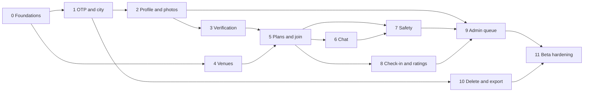

# Implementation plan (P0)

Build order for release stage 1 ("MVP build", weeks 4–16 in the PRD), starting once the Stitch frames for a slice exist. Each slice is a vertical cut: migration, RLS, RPC or Edge Function, mobile screens, admin screens where needed, tests, analytics events. A slice is done only when its "Works when" checks pass on staging.

Route IDs refer to the inventory in [README.md](README.md). Rules S-n are in [security.md](security.md).

## How each slice is built

1. Migration with tables, RLS, helper functions, and pgTAP tests for every S-rule the slice touches.
2. RPCs and Edge Functions with tests (pgTAP for SQL, Deno tests for Edge).
3. Regenerate database types into `packages/shared`.
4. Screens: read the Stitch frame with the Stitch MCP; build from `apps/mobile/src/ui` primitives and `theme.ts` tokens. Add a primitive only when two screens need it. Admin screens use the same tokens in plain CSS.
5. Copy is English only and lives in the screen; there is no i18n layer.
6. Analytics events from the table at the end of this doc, using the shared typed wrapper.
7. Demo on a staging development build.

## Slices

### 0. Foundations

Closes: none directly; prerequisite for all.

- Monorepo (`apps/mobile`, `apps/admin`, `supabase/`, `packages/shared`), pnpm, TypeScript strict.
- Supabase projects: local (CLI), staging and production in `ap-south-1`. Migrations applied by CI.
- Expo SDK 57 app with Expo Router and the `src/ui` design system, all libraries listed in [architecture.md](architecture.md); EAS `development`, `preview`, `production` profiles.
- Admin app on Vercel (`bom1`), admin login with TOTP.
- Sentry (scrubber, S-9), PostHog (allow-listed wrapper plus server-side outbox), React Query + MMKV persistence.
- CI (`.github/workflows/ci.yml`): typecheck, shared tests, secret scan (S-2), admin build, Android JS bundle, Deno check and tests, pgTAP (S-1, S-5 and the rest of security.md), type-drift check, gitleaks. ESLint and Prettier are not set up yet.
- Start external lead-time items now: MSG91 DLT registration and template, HyperVerge contract and sandbox, AWS account with Rekognition in `ap-south-1`, Google Play developer account, Maps API key.

Works when: a development build on an Android 8 device opens, reports a test error to Sentry with only a user ID, and CI is green with all checks enabled.

### 1. OTP sign-in and city waitlist

Closes: ON-1, ON-2.
Routes: `(auth)/index`, `(auth)/age`, `(auth)/phone`, `(auth)/otp` (with lockout state), `(onboarding)/consent`, `(onboarding)/city`, `(onboarding)/waitlist`.
Admin: `/cities` (AD-4 status only).

- `cities`, `waitlist_signups`, `consents`, `profiles` row trigger, `private.otp_attempts`.
- `send-sms` hook to MSG91; `otp-verify` with lockout (S-10, S-11); SMS Retriever autofill.
- Consent screen (C-1).

Works when: OTP arrives in under 30 s on Jio and Airtel numbers in staging; the 6th try within 30 minutes is refused with the lock screen; picking a waitlist city saves a `waitlist_signups` row and shows the waitlist screen; `auth.users.phone` is the only place the number exists.

Events: `otp_requested`, `otp_verified`, `city_selected`.

### 2. Profile and photo gate

Closes: ON-3, ON-4, VR-4 (profile text and photos).
Routes: `(onboarding)/profile`, `(onboarding)/photos`, `(onboarding)/interests`, `(onboarding)/rules`, `settings/profile`, `user/[id]`.

- `profile_photos`, `interests`, `colleges`, `profile_stats`, `public_profiles` view.
- Quarantine upload, `moderate-image` with Rekognition, EXIF strip, hash cache (S-21 to S-24).
- `screen_text` trigger and `private.screen_terms` seeded in Hindi, Hinglish, English (S-20).
- Community rules screen recorded in `consents` (C-3).
- Area picker: user picks an area name from a city list; stored as `area_name` + `area_cell` (no GPS needed).

Works when: a profile with 1 approved photo cannot be completed; a nude test image never appears to another user and lands in the queue; a bio containing "98 765 43210" or "insta @x" is rejected; other users see the age band, never the birth year.

Events: `profile_completed`.

### 3. Verification

Closes: VR-1, VR-2, VR-3, VR-7.
Routes: `verify`, `verify/result`, `verify-gate` (sheet). The ID and selfie steps run inside HyperVerge's web flow, so there are no separate app screens for them.

- `verification_checks`, `private.identity_fingerprints`, `private.kyc_cache`.
- `kyc-start`, `kyc-webhook` (S-38, S-39); thresholds in `private.settings`; one retry then manual review.
- Under-18 ban path (S-40). Verified badge.
- Verification gate sheet `plan/[id]/verify-gate` (used by slice 5).

Works when: a HyperVerge sandbox adult passes and gets the badge; a sandbox minor is banned and cannot sign up again with a new number using the same ID; a borderline face match shows the manual-review message with expected reply time; no Aadhaar number, image, or full DOB appears in any table or log; a second account using the same ID is refused.

Events: `verification_started`, `verification_passed`, `verification_failed`.

### 4. Venues

Closes: VN-1, SF-1, AD-4 (venue list).
Routes: `venues`, `venue/[id]`.
Admin: `/venues`, `/venues/[id]`.

- `venues`, `venue_photos`; admin create, edit, approve, archive with audit (S-45). `late_events_allowed` flag (partner override).
- Map with `react-native-maps`, venue pin only.

Works when: a draft venue is invisible in the app; an approved one appears only in its city; every approval has an `audit_log` row.

### 5. Plans and join

Closes: PL-1, PL-2, PL-3, PL-4, PL-5, ON-5, SB-1, SF-5 (joins), SF-6.
Routes: `(tabs)/feed`, `(tabs)/feed/filters`, `plan/[id]`, `plan/[id]/verify-gate`, `plan/create`, `plan/create/venue`, `(tabs)/my-plans`, `plan/[id]/requests`, `plan/[id]/cancel`.

- `plans`, `plan_members`, `activities`, `usage_counters`, `feed_plans` view, indexes.
- RPCs: `create_plan` (S-26, S-31 to S-34), `request_join` (S-25, S-27), `decide_join`, `leave_plan`, `cancel_plan`.
- `plan_lifecycle_tick` cron (transitions and expiry).
- Push for join requests, approvals, cancellations (`push` function, `push_tokens`).
- Feed with keyset pagination and filters; offline cache.

Works when: the pgTAP suite in security.md passes (women-only zero rows, caps, 3-hour lead, 21:00 cut-off); an unverified user can read the feed but tapping Join opens the verify gate; a decline shows no reason and returns the slot; a host cancel at T–2h is flagged late and members get a push; feed first page renders in under 2 s on a mid-range Android on 4G in staging with 500 seeded plans.

Events: `plan_viewed`, `join_requested`, `join_approved`, `plan_created`, `plan_cancelled`.

### 6. Group chat

Closes: CH-1, CH-2, CH-3, SF-5 (messages).
Routes: `(tabs)/chats`, `chat/[conversationId]`, `chat/[conversationId]/members`.

- `conversations`, `messages`, `conversation_mutes`; Realtime publication; RLS (S-17).
- `screen_text` on messages, `enforce_message_caps` (S-27, S-28), chat photo pipeline with blur-until-tap.
- Offline outbox in MMKV with client UUIDs; close job (24 h after end).
- Push on new message with generic copy (S-48).

Works when: message delivery p95 is under 1 s between two devices on staging; a phone number in any format is refused; the 21st message on day 2 for a new account fails; messages sent offline appear once (no duplicates) after reconnect; a chat is read-only 24 h after the plan ends.

### 7. Safety, blocks, reports, SOS

Closes: CH-4, SF-2, SF-3, VR-5, SB-5.
Routes: `report` sheet, `settings/blocked`, `safety/trusted-contact`, `safety/sos`, `suspended`.

- `reports`, `blocks`, `submit_report`, `block_user` with auto-suspend (VR-5) and in-plan mute and hold.
- Trusted contact in secure storage; WhatsApp share and SOS (S-50, S-51); 112 button.
- Report and block entry points on every surface listed in [moderation-and-safety.md](moderation-and-safety.md).

Works when: a blocked user disappears from the blocker's feed, plan member lists, and chat immediately; two reports from different verified users suspend the target and show the reason screen; SOS opens WhatsApp with a maps link and the server has no coordinate stored; none of these actions checks entitlement.

Events: `report_submitted`, `user_blocked`, `sos_pressed`.

### 8. Check-in and ratings

Closes: PL-6, SF-4, PL-5 (attended / no-show).
Routes: `plan/[id]/check-in`, `plan/[id]/rate`.

- `check-in` Edge Function (S-36, S-37).
- `ratings`, `submit_rating`, `rating_prompt_tick`, unsafe-rating trigger; `profile_stats` updates; no-show priority.

Works when: check-in at 151 m or 31 minutes before start fails, at 100 m and 10 minutes before succeeds; no coordinate appears in tables or logs; the rating prompt arrives about 1 h after end; two unsafe ratings from different members create a severe queue item.

Events: `check_in`, `plan_completed`, `rating_submitted`.

### 9. Admin console: queue, lookup, actions, appeals

Closes: AD-1, AD-2, AD-3, SF-7, VR-6.
Routes: `appeal`, `settings/appeals`, `suspended`.
Admin: `/queue`, `/queue/[id]`, `/users`, `/users/[id]`, `/plans/[id]`, `/appeals`, `/audit`.

- `moderation_queue` views, `appeals`, `audit_log` (insert-only, S-46), custom access token hook (S-43), MFA requirement (S-44).
- Actions: approve, reject, escalate, warn, suspend, ban, restore, mute, remove from plan, cancel plan, remove message.
- `queue_age_tick` alert; severe-item page.

Works when: every action creates an audit row with reason; a reviewer cannot ban (admin only); an update to `audit_log` fails for every role; a severe report pages the on-call admin within a minute; an appeal shows its 48 h due time and the user sees the answer in-app.

Events: `appeal_submitted`.

### 10. Account deletion and export

Closes: ON-6.
Routes: `settings`, `settings/privacy`, `settings/delete`, `help`.

- `delete-account` (revoke sessions, hide profile, withdraw joins, cancel hosted plans, schedule purge), `retention_tick`, `private.deletion_jobs`.
- `export-data` JSON file, `data_exports`.
- Web deletion request page for Play.
- Grievance officer contact on `help`.

Works when: delete is reachable in 3 taps from settings; after purge, no row references the user except retained safety records; export downloads as a file with the listed contents; PostHog person is deleted.

### 11. Beta hardening

Closes: performance and reliability NFRs; readiness for closed beta (stage 2).

- Load test on staging: 10,000 MAU profile, 500 concurrent chat channels, feed RPC under load.
- Cold start under 3 s on an EAS production build on a mid-range Android.
- Accessibility pass: 130% text, 44 px targets, TalkBack labels on primary actions.
- Copy review of every screen against the Stitch frames and the community rules.
- Backups and PITR verified by a restore drill.
- Rekognition quota increase requested; cost-guard alerts tested.
- Play data safety form and UGC requirements checked against [privacy-and-compliance.md](privacy-and-compliance.md).
- Internal test with 30 friends (PRD stage 1 exit gate): verification pass rate above 70%.

Works when: all budgets in [architecture.md](architecture.md) are met with Sentry evidence, and the stage 1 exit gate is met.

## Dependencies

Slice 4 (venues) and the admin shell can run in parallel with slices 1–3. Slice 9's queue view can start after slice 2 (photos and text are the first queue items) and grow as slices 3, 7, and 8 add subjects.

## P0 requirement coverage

| Requirement | Slice |
| ----------- | ----- |
| ON-1, ON-2 | 1 |
| ON-3, ON-4 | 2 |
| ON-5 | 5 (gate built in 3) |
| ON-6 | 10 |
| VR-1, VR-2, VR-3, VR-7 | 3 |
| VR-4 | 2 (profile), 6 (chat) |
| VR-5 | 7 |
| VR-6 | 9 |
| PL-1 to PL-5 | 5 |
| PL-6 | 8 |
| CH-1 to CH-3 | 6 |
| CH-4 | 7 |
| SF-1 | 4 |
| SF-2, SF-3 | 7 |
| SF-4 | 8 |
| SF-5 | 5 (joins), 6 (messages) |
| SF-6 | 5 |
| SF-7 | 9 |
| SB-1 | 5 |
| SB-5 | 7 (verified across all slices) |
| VN-1 | 4 |
| AD-1 to AD-3 | 9 |
| AD-4 | 1 (cities), 4 (venues) |

## Analytics events

Names are fixed here so screens do not rename them. All go through the typed wrapper in `packages/shared`; properties are allow-listed (no PII, S-9). Every event carries `city` (slug) automatically.

| Event | Fired when | Properties | Slice |
| ----- | ---------- | ---------- | ----- |
| `otp_requested` | OTP send succeeds | `resend` (bool) | 1 |
| `otp_verified` | Session created | `new_user` (bool) | 1 |
| `city_selected` | City confirmed | `city_status` | 1 |
| `profile_completed` | Profile becomes active | `photo_count`, `interest_count` | 2 |
| `verification_started` | `kyc-start` returns a session | `attempt` | 3 |
| `verification_passed` | All three checks pass | `attempt`, `manual` (bool) | 3 |
| `verification_failed` | A check fails or goes to manual review | `check_type`, `outcome` (`fail`, `review`, `minor`) | 3 |
| `appeal_submitted` | Appeal created | `subject` | 9 |
| `plan_viewed` | Plan detail opened | `plan_id`, `audience`, `activity`, `source` (`feed`, `link`, `my_plans`) | 5 |
| `join_requested` | Join request created | `plan_id` | 5 |
| `join_approved` | Host approves (fired for the requester, server-side) | `plan_id`, `wait_minutes` | 5 |
| `plan_created` | Plan created | `plan_id`, `activity`, `audience`, `capacity`, `lead_hours` | 5 |
| `check_in` | Check-in succeeds | `plan_id`, `minutes_from_start` | 8 |
| `plan_completed` | Lifecycle marks completed (server-side) | `plan_id`, `attended_count` | 8 |
| `plan_cancelled` | Host or admin cancels | `plan_id`, `late` (bool), `by` (`host`, `admin`) | 5 |
| `report_submitted` | Report created | `reason`, `severity`, `context` (`profile`, `plan`, `message`) | 7 |
| `user_blocked` | Block created | `context` | 7 |
| `sos_pressed` | SOS sheet opened | `plan_id`, `location_sent` (bool) | 7 |
| `rating_submitted` | Rating batch saved | `plan_id`, `rated_count` | 8 |
| `paywall_viewed` | P1 | `trigger` | P1 |
| `subscription_started` | P1, from webhook | `product_id` | P1 |
| `ticket_purchased` | P1, from webhook | `plan_id`, `amount_paise` | P1 |
| `venue_offer_redeemed` | P1 | `venue_id` | P1 |

Server-side events (`join_approved`, `plan_completed`, `subscription_started`, `ticket_purchased`) are sent from Edge Functions or a cron-driven outbox using the PostHog capture API with the same allow-list, so they are not lost when the app is closed.

North-star and goal metrics (plans that happened, women share, 30-day repeat joiners, reports per 1,000 attendances, verification pass rate) are computed from Postgres, not PostHog, because they depend on verified gender and check-ins that analytics must not carry.

## After P0

P1 (subscriptions, ticketed plans, masked calls, curated tables, venue offers and billing, 1:1 chat, voice notes, contact cards, metrics dashboard) gets its own plan after the closed beta, using the slots reserved in [architecture.md](architecture.md) and [data-model.md](data-model.md).
