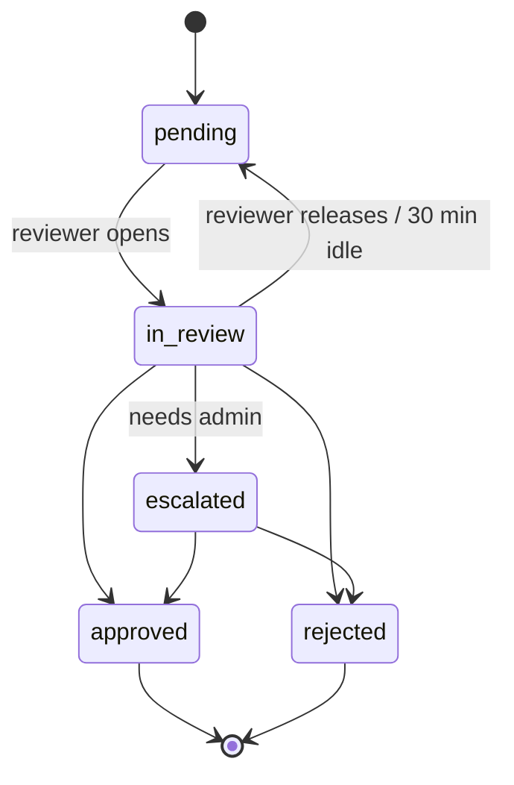

# Moderation and safety

How content and people are screened, reviewed, suspended, and restored, and how the safety features work. The team is two people at launch (PRD persona "City admin"), so automation does the first pass and humans decide anything that removes access. Rules referenced as S-n are in [security.md](security.md).

## Principles (from PRD §5)

1. Group first: no 1:1 contact until two people share a completed plan (P0 has no 1:1 chat at all).
2. Public places only: approved venues, plans end by 21:00 unless a partner venue opts out.
3. Safety is free: report, block, leave, SOS, trusted contact, check-in, and masking are never behind a paywall or a cap (SB-5, S-30).
4. Severe reports are read by a human within 12 hours.
5. Say no quietly: declined join requests never show a reason.

## What enters the queue

Every item is a `moderation_queue` row with a subject, an owner, severity, the AI verdict and score if any, and a `due_at`.

| Subject | Created when | Severity | AI first pass |
| ------- | ------------ | -------- | ------------- |
| `photo` | Rekognition result is borderline or reject; profile photo with no face; Rekognition failed after retries | standard | Rekognition labels and confidence |
| `text` | `screen_text` holds a bio, name, plan title, plan description, join note, or message | standard | Term-list match (which list, which term) |
| `verification` | KYC result `review` (borderline face match, gender mismatch with declared, unreadable ID), second liveness failure, webhook missing for 1 h | standard | HyperVerge scores and reason codes |
| `report` | Any `reports` insert | severe or standard by reason | none |
| `rating_review` | Second "felt unsafe" rating about the same user within 30 days (SF-4) | severe | none |
| `venue` | New venue submitted by an admin for second-person approval (optional), or a report naming a venue | standard | none |
| `appeal` | Any `appeals` insert | standard | none |

Severe report reasons: `sexual_content`, `threat_or_violence`, `underage`, `unsafe_at_plan`.

## Queue states

- `in_review` sets `assigned_to`; a lock older than 30 minutes is released so items do not stall.
- `approved` means the subject is fine (photo shown, text visible, verification passed, report dismissed). `rejected` means the subject is removed or the action is taken (photo rejected, text rejected, verification failed, report actioned).
- `escalated` is for reviewers to hand to an `admin` (bans, under-18 suspicions, anything legal). Only `admin` resolves escalated items.
- Every decision requires a `decision_reason` and writes `audit_log` in the same transaction (S-45). AI verdict and the human decision are both kept on the row for appeals (PRD §5 "moderation records").

## SLAs and alerts

| Item | Target | Alert |
| ---- | ------ | ----- |
| Severe report, unsafe-rating review | Human decision within 12 h (SF-7) | Push and email to on-duty admin at creation; page again at 8 h if still pending |
| Standard report, verification review, photo, text | Within 24 h | — |
| Appeal | Human answer within 48 h (VR-6) | Daily digest of appeals older than 24 h |
| Any item | — | `queue_age_tick` (every 15 min) pages when the oldest pending item is older than 24 h (PRD NFR) |

Operating rhythm: two queue passes a day (morning and night) plus on-call for severe pages. PRD risk mitigation: hire a part-time moderator at 2,000 MAU; the `reviewer` role exists for that.

## Automatic actions (no human first)

These are the only automatic restrictions. Each is reversible by a human and each tells the user why.

| Trigger | Action | User sees |
| ------- | ------ | --------- |
| 2 reports from 2 different users within 30 days (VR-5) | `profiles.status = 'suspended'`, sessions kept so they can read the reason; pending joins withdrawn; future hosted plans paused (hidden, members notified the plan is on hold) | `suspended` screen: "Your account is paused while we review reports. We'll reply within 24 hours." Appeal button. |
| 1 severe report with reason `underage` | Suspended as above, escalated | Same, plus prompt to re-verify |
| Rekognition reject on a photo | Photo `rejected`, not shown | Photo marked "Not approved", reason category only (e.g. "nudity", "no face") |
| Text matches a `reject` term (phone, URL, handle) | Insert rejected; nothing stored | Inline: "Phone numbers and links can't be shared here" |
| Text matches a `hold` term | Stored `held`, visible to author only | "Pending review" |
| KYC minor verdict | Banned (S-40) | "You must be 18 or older to use Yuvomeet." Appeal only for "result is wrong". |
| 3 no-shows in 30 days | Lower join priority: requests sort last in the host's list | Nothing (no penalty notice; PRD edge case) |
| 2+ late cancels by a host in 30 days | Host's plans sorted after others on the same day (PL-5) | On the cancel sheet: "Late cancellations reduce how often your plans are shown." |

Reports from users who are themselves suspended or from blocked pairs still create queue items but do not count toward the VR-5 threshold (prevents brigading by a banned user's alts). The VR-5 count uses distinct reporters with `verified` status.

## Reviewer actions (admin console)

From `/queue/[id]` and `/users/[id]`, one click each with a required reason (AD-1, AD-3):

- **Approve / reject** the subject.
- **Warn** the user (in-app notice, no restriction).
- **Suspend** for a period (24 h, 7 d, until appeal) — `reviewer` and `admin`.
- **Ban** — `admin` only. Revokes sessions (S-12), cancels hosted plans, removes from member lists, records `id_fingerprint` as banned so a new number cannot re-register with the same ID.
- **Restore** — `admin` only, for suspended or banned accounts.
- **Mute in conversation**, **remove from plan**, **cancel plan**, **remove message**.
- **Escalate**.

The reviewer sees for a user: AI verdicts and scores, reports received and given (AD-2), ratings aggregates and individual unsafe ratings, no-show and late-cancel counts, action history from `audit_log`, and the reported messages with surrounding context (10 messages either side). Reviewers do not see phone numbers (S-6); if police need one, an admin retrieves it through the documented law-enforcement procedure ([privacy-and-compliance.md](privacy-and-compliance.md)).

## Reports from inside a plan

PRD §4 edge case: a member reports someone during or right after a plan.

1. Report submitted with `plan_id` (and `message_id` if from a message).
2. The reported user is inserted into `conversation_mutes` for that plan's conversation: they can read but not post. Other members see nothing about who reported.
3. The conversation's `hold_until` is set to `max(closes_at, now() + 24 h)`, so the thread stays readable for at least 24 hours for evidence. It is still read-only for everyone after `closes_at`, but not deleted.
4. If severe, the SLA page fires.
5. Reporter is offered "Block this person too" and the SOS sheet if the plan is in progress.

## Ratings (SF-4)

- `rating_prompt_tick` sends a push 1 hour after `ends_at` to members marked `attended`, and a card appears in `(tabs)/my-plans`.
- The rater answers, for each co-member: "Felt safe?" and "Showed up?". Ratings are private: only admins see individual rows; users see aggregates on profiles (show-up rate, only after 3 plans).
- Two "felt unsafe" ratings about the same user, from different raters, within 30 days create a severe `rating_review` item. They do not auto-suspend; a human decides.
- "Didn't show up" ratings are cross-checked against `checked_in_at`; a no-show with a check-in is not counted.
- Ratings window: 7 days after the plan.

## Join decisions

- Host sees for each requester: verified badge, first name, age band, interests, photos, plans attended, show-up rate (≥ 3 plans), and the optional note (PL-3).
- Decline sends "This plan couldn't take you this time" with no reason, the same text as an expired request (principle 5). The declined slot returns to the user's weekly cap (S-25).
- Hosts who decline every woman or every man across many plans are a pattern worth reviewing; a weekly report lists hosts with ≥ 10 decisions and a ≥ 90% skew. (P0: admin report only, no automatic action.)

## Host cancellation

- `cancel_plan` RPC requires a reason (shown to members).
- Within 3 hours of `starts_at`: `late_cancel = true`, members notified by push immediately, host's `late_cancel_count_30d` incremented (PL-5, PRD §4 edge case).
- Cancelling returns members' join slots.

## Safety features

| Feature | Behavior | Notes |
| ------- | -------- | ----- |
| Approved public venues (SF-1) | Admin creates and approves every venue; must be a commercial or public place with staff. Home addresses and private flats are rejected. | Venue checklist in the admin form |
| Trusted contact (SF-2) | Set once in `safety/trusted-contact` (name and number in secure storage on device). "Share plan" opens WhatsApp with venue name, address, start time, host first name, and a map link to the venue. | S-50 |
| SOS (SF-3) | Available on plan detail and chat from 1 hour before start until 2 hours after end. One tap opens the SOS sheet: big 112 call button, and "Send my location" which takes one GPS fix and opens WhatsApp to the trusted contact with a maps link and the plan details. No trusted contact set → share sheet. Server logs `sos_pressed` only. | S-51; after an SOS, admin on-call gets a page with plan ID (not location) to follow up in-app |
| Check-in (PL-6) | 150 m, ±30 minutes of start, one fix verified server-side and discarded | S-36 |
| 21:00 cut-off (SF-6) | Enforced in `create_plan` | S-32 |
| New-account limits (SF-5) | 5 join requests and 20 messages a day for the first 7 days | S-27 |
| Number and link masking (CH-3) | Trigger rejects phone numbers, links, and handles in plan chats | S-20 |
| Report, block, leave (CH-4) | Reachable from profile, plan detail, member list, every message (long press), and chat header | S-17 |

## Appeals (VR-6)

- Users can appeal any verification rejection, suspension, ban, or content rejection from `suspended`, `(verify)/result`, `settings/appeals`, or the rejected item.
- One open appeal per subject. Appeal text is screened (S-20) but never auto-rejected; held terms just flag it.
- Appeals go to `/appeals` with `due_at = created + 48 h`. The appeal reviewer must not be the person who made the original decision when two reviewers exist (shown as a warning, not enforced, while the team is two people).
- Outcomes: `upheld` (decision reversed; user restored, photo approved, verification passed, etc.) or `denied` (decision stands, with a short human-written reason). Both notify the user in-app.
- Verification appeals may request a re-check: the reviewer can grant one extra KYC attempt, which is the only way a paid check runs beyond the retry limit.
- Under-18: appeal accepted only if the result is plausibly wrong (provider error). A confirmed minor result is final (S-40).
- Failed selfie twice (PRD §4 edge case): the user sees "We're checking your photos by hand. Expect a reply within 24 hours," never a bare "rejected". This is a manual review item, not an appeal, and needs no action from the user.

## Metrics to watch (beta)

From admin SQL views until the P1 metrics dashboard (AD-5):

- Reports per 1,000 plan attendances (target under 5) and share reviewed within 12 h (target 100% of severe).
- Queue age p50 / max; appeals answered within 48 h.
- Verification pass rate on first or second try (target 70%+), and manual-review rate.
- Auto-suspensions later restored on review (false-positive rate of VR-5).
- Photo rejection rate and appeal-upheld rate (to tune Rekognition thresholds).
